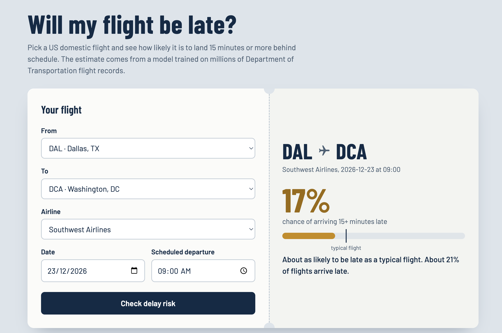
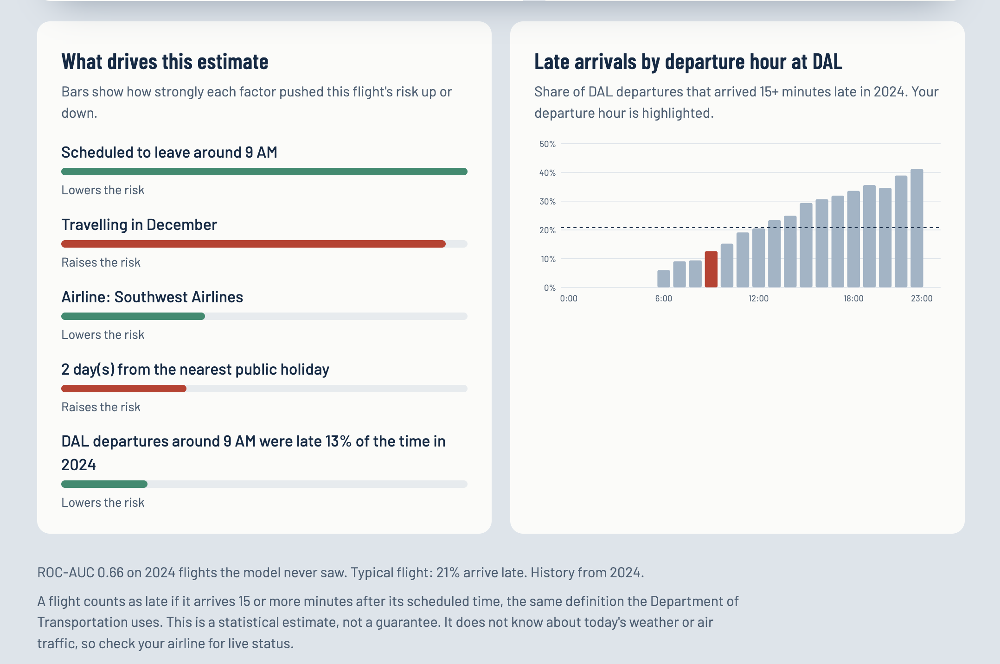
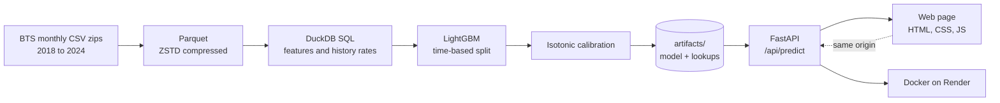

<div align="center">

# ✈️ Flight Delay Predictor

**Will your flight land 15+ minutes late? A machine-learning app trained on 40+ million US DOT flight records.**

[](https://flight-delay-predictor-87mn.onrender.com)
[](https://github.com/arpitk2509/flight-delay-predictor/actions/workflows/ci.yml)


[**Try the live app**](https://flight-delay-predictor-87mn.onrender.com) · [How it works](#-how-it-works) · [Results](#-results) · [Run it locally](#-run-it-locally) · [API](#-api)

<br>



<sub>The free server sleeps when idle, so the first load can take up to a minute.</sub>

</div>

---

## Contents

- [What it does](#-what-it-does)
- [How it works](#-how-it-works)
- [Results](#-results)
- [Key design decisions](#-key-design-decisions)
- [Tech stack](#-tech-stack)
- [Run it locally](#-run-it-locally)
- [Reproduce the training](#-reproduce-the-training)
- [API](#-api)
- [Deployment](#-deployment)
- [Project structure](#-project-structure)
- [Limitations and roadmap](#-limitations-and-roadmap)
- [Data and credits](#-data-and-credits)

## 🎯 What it does

Pick a US domestic route, an airline, a date and a scheduled departure time. The app returns:

- the **probability** that the flight arrives **15 or more minutes late** (the official DOT definition of "delayed"),
- a **risk band** (low, medium, high) relative to a typical flight,
- the **top reasons** behind the estimate, such as departure hour, last year's delay rate at that airport, or the airline's record,
- a chart of **late-arrival rate by departure hour** at the origin airport.

Everything is computed from information known **before departure**, so the estimate is something a passenger could really use when booking.

<br>



<br>

## 🧭 How it works



1. **Ingest:** `src/download_data.py` downloads each monthly file from the Bureau of Transportation Statistics and converts it to compact Parquet, keeping about 20 of the 100+ columns.
2. **Features:** `src/features.py` uses DuckDB to compute calendar features and smoothed delay rates (airline, origin, destination, route, origin-hour) from the **previous year only**.
3. **Train:** `src/train.py` trains LightGBM on 2019 to 2022, tunes on 2023, and reports once on the untouched 2024 test year.
4. **Serve:** `api/main.py` loads the model once at startup and exposes JSON endpoints. The same FastAPI app also serves the web page, so there is a single deployment and no CORS setup.

## 📊 Results

Evaluated on **2024 flights the model never saw** (a random sample of 2 million flights from the test year).

| Model | ROC-AUC | PR-AUC | Brier score |
|---|---:|---:|---:|
| Always predict the base rate (about 21% late) | 0.500 | 0.208 | 0.166 |
| Last year's route delay rate only | 0.565 | 0.246 | 0.164 |
| Last year's origin-airport + hour delay rate only | 0.630 | 0.289 | 0.159 |
| LightGBM, first run (127 leaves, learning rate 0.05) | 0.655 | 0.322 | 0.157 |
| **LightGBM, tuned (31 leaves, learning rate 0.03)** | **≈ 0.66** | **≈ 0.33** | **≈ 0.156** |

**Reading the numbers**

- About one flight in five is late, so accuracy would be misleading (always saying "on time" scores about 79%). The project uses **ROC-AUC, PR-AUC and Brier score** instead.
- The model beats every simple baseline. An AUC around 0.66 is realistic for schedule-and-history features. The main signals it cannot see (weather and the delay of the incoming aircraft) are the biggest opportunities, listed in the [roadmap](#-limitations-and-roadmap).
- Validation AUC (about 0.66) and test AUC are almost identical, which is what a clean time-based split should look like. There is no sign of leakage.
- LightGBM was already well calibrated. Isotonic calibration improved the Brier score by only about 0.0001, so predicted probabilities can be read at face value.

**Most important features (by gain):** departure hour, airline delay rate, origin airport, month, airline, destination, origin-hour delay rate, day of month.

<sub>Values marked ≈ are from the tuned run; exact figures for every run are written to `artifacts/metrics.json` by the training script.</sub>

## 🧠 Key design decisions

**1. No data leakage.** The raw BTS file contains columns such as `DepDelay`, `TaxiOut`, `WheelsOff` and `ArrTime` that only exist after the flight starts. Using them gives a near-perfect score and a useless model. The notebook demonstrates this: adding `dep_delay` pushes AUC to about 1.0. The deployed model only uses schedule, route, airline, calendar and historical information.

**2. Time-based split, never random.** 2018 builds history, 2019 to 2022 train, 2023 validates and early-stops, and 2024 is the test set, used once. A random split would let the model learn from the future.

**3. History features without target leakage.** For a flight in year *Y*, delay rates come from year *Y − 1* only, smoothed as `(delays + 20 × overall rate) / (flights + 20)` so small groups shrink toward the average. At prediction time the latest full year plays the role of "last year".

**4. Calibrated probabilities.** Because the app shows a percentage to users, probabilities should mean what they say. An isotonic regression is fitted on the validation year and checked on the test year.

**5. Explanations without extra dependencies.** LightGBM's built-in `pred_contrib` returns SHAP-style per-feature contributions for a single prediction. The top five are shown with their direction.

**6. Same code in training and serving.** Calendar features and categorical encoding live in one module used by both, which avoids training/serving skew. Heavy training-only dependencies (DuckDB) are imported lazily, so the web image stays small.

## 🧰 Tech stack

| Layer | Tools |
|---|---|
| Data | BTS On-Time Performance, Parquet (ZSTD), DuckDB |
| Modelling | LightGBM, scikit-learn (metrics, isotonic calibration), pandas |
| API | FastAPI, Pydantic validation, Uvicorn |
| Frontend | Plain HTML, CSS and JavaScript (no build step), inline SVG chart |
| Packaging | Docker (`python:3.13-slim`), pinned `requirements-serve.txt` |
| Hosting | Render (free web service) |
| Quality | pytest + FastAPI TestClient, GitHub Actions CI |

## 💻 Run it locally

Requires Python 3.10+.

```bash
git clone https://github.com/arpitk2509/flight-delay-predictor.git
cd flight-delay-predictor
python3 -m venv .venv && source .venv/bin/activate
pip install -r requirements.txt
```

> **macOS:** LightGBM needs OpenMP. If you see `Library not loaded: libomp.dylib`, run `brew install libomp`.

The repository includes a trained model in `artifacts/`, so you can start the app straight away:

```bash
uvicorn api.main:app --reload --port 8000
```

Open <http://localhost:8000> for the web app and <http://localhost:8000/docs> for interactive API docs.

Run the tests with `pytest -q`.

## 🔁 Reproduce the training

```bash
# 1. Download and convert the data (about 84 monthly files; see the note below)
python3 -m src.download_data --start-year 2018 --end-year 2024

# 2. Train, evaluate, calibrate and save artifacts/
python3 -m src.train --max-train-rows 3000000 --memory-limit 4GB

# Tuned run used for the deployed model
python3 -m src.train --num-leaves 31 --learning-rate 0.03 --max-train-rows 3000000
```

- The BTS server can be slow or reset connections. The downloader retries automatically and skips months it already has, so you can safely re-run it.
- You need at least **4 consecutive years** of data (one for history, then train, validation and test).
- Want to try the pipeline without downloading anything? `python3 scripts/make_sample_data.py` generates synthetic data with the same columns (for testing only).
- A step-by-step walkthrough with EDA, a leakage demonstration, baselines and calibration plots is in [`notebooks/flight_delay_end_to_end.ipynb`](notebooks/flight_delay_end_to_end.ipynb).

## 🔌 API

| Method | Endpoint | Purpose |
|---|---|---|
| `GET` | `/api/health` | Liveness check |
| `GET` | `/api/meta` | Airports, model metrics, base rate |
| `GET` | `/api/destinations?origin=ORD` | Destinations flown from an airport |
| `GET` | `/api/carriers?origin=ORD&dest=LAX` | Airlines flying that route |
| `POST` | `/api/predict` | Delay probability and reasons |

**Request**

```json
{
  "flight_date": "2026-11-20",
  "dep_time": "18:30",
  "carrier": "UA",
  "origin": "ORD",
  "dest": "LAX"
}
```

**Response** (shortened, values illustrative)

```json
{
  "probability": 0.27,
  "base_rate": 0.208,
  "risk": "medium",
  "reasons": [
    {"feature": "dep_hour", "text": "Scheduled to leave around 6 PM", "direction": "up", "weight": 0.31},
    {"feature": "origin_hour_rate", "text": "ORD departures around 6 PM were late 26% of the time in 2024", "direction": "up", "weight": 0.18}
  ],
  "context": {"hourly_origin_rates": ["... 24 values ..."], "selected_hour": 18}
}
```

Invalid input returns `422`. A route that does not exist in the data returns `404` with a clear message (the UI only offers valid routes).

## 🚀 Deployment

The Docker image contains only the code and the small trained model (under 1 MB), not the dataset.

```bash
docker build -t flight-delay .
docker run --rm -p 7860:7860 flight-delay      # http://localhost:7860
```

Deployed on **Render** (free tier) straight from this repository:

1. New → Web Service → connect the repo.
2. Language: **Docker**, instance type: **Free**, health check path: `/api/health`.
3. Auto-deploy on every push to `main`.

The container reads the `PORT` environment variable, so the same image also works on Google Cloud Run. Resident memory when serving is roughly 100 to 200 MB, comfortably inside the free 512 MB tier.

## 🗂 Project structure

```
flight-delay-predictor/
├── api/main.py              FastAPI routes; also serves web/
├── src/
│   ├── config.py            paths, constants, feature lists
│   ├── download_data.py     BTS zip → Parquet
│   ├── features.py          SQL features, calendar features, time split
│   ├── train.py             baselines, LightGBM, calibration, artifacts
│   ├── lookups.py           small tables used at prediction time
│   └── predictor.py         inputs → features → probability + reasons
├── web/                     index.html, style.css, app.js
├── artifacts/               trained model, lookups, metrics.json
├── notebooks/               end-to-end learning notebook
├── tests/test_api.py        API tests
├── scripts/                 synthetic data generator, local run helper
├── Dockerfile
└── .github/workflows/ci.yml
```

## ⚠️ Limitations and roadmap

**Known limitations**

- No live weather, air-traffic or inbound-aircraft information, so the model captures typical patterns, not today's disruptions.
- Historical rates come from the latest full year and age over time.
- 2020 and 2021 (COVID years) are inside the training window and are treated like any other year.
- Training uses a random sample of up to 3 million flights so it fits on a laptop.

**Roadmap**

- [ ] Weather features by airport and hour (Meteostat or NOAA)
- [ ] Previous leg of the same aircraft (tail-number rotation), likely the strongest signal
- [ ] Hyperparameter search with Optuna and run tracking with MLflow
- [ ] Rolling-window (time-series) cross-validation
- [ ] Drift monitoring and scheduled monthly retraining
- [ ] Data warehouse layer (star schema with dbt) feeding both the model and a dashboard

## 📚 Data and credits

Flight data: US Department of Transportation, Bureau of Transportation Statistics,
[Reporting Carrier On-Time Performance (1987 to present)](https://www.transtats.bts.gov/Tables.asp?QO_VQ=EFD). Public domain.

Built by **Arpit Kumar** ([@arpitk2509](https://github.com/arpitk2509)). Built with an AI coding assistant as a pair-programmer; I ran the experiments, evaluated the results, deployed it and debugged the issues along the way.
